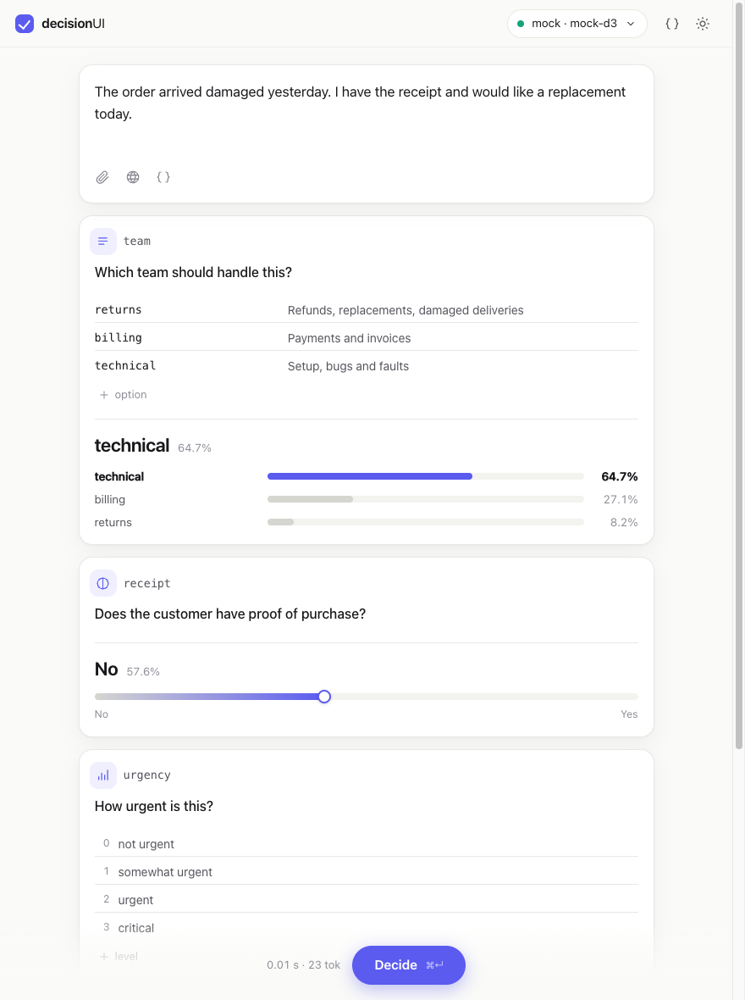
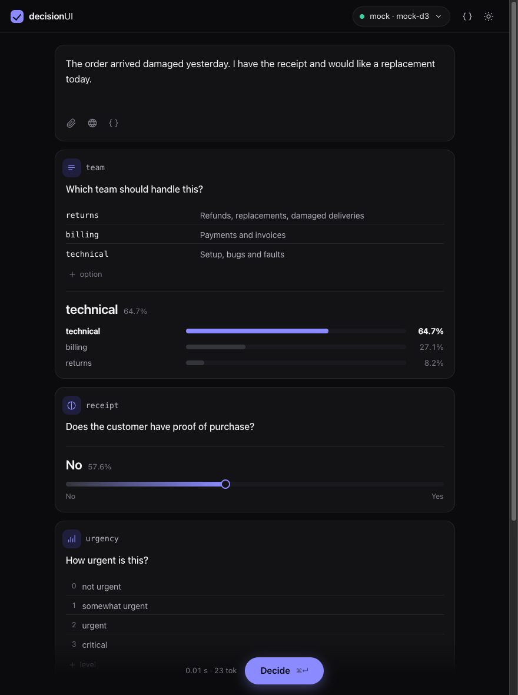

<h1 align="center">decisionUI</h1>

<p align="center">A clean web UI for <b>System One</b> decision models.<br>Ask typed questions about any input, see calibrated answers.</p>

<p align="center">
  
  
</p>

Decision models (d3, Clef, OpenJev, …) don't chat. You give them an input and questions, they return a probability for every option. decisionUI is a front end for that API, for any endpoint that speaks it.

- **Question types:** choice, yes / no, score: the System One standard. **Extensions** (box, track, tagged images, long context) are d3-turbo features: flip *Extensions* in the endpoint menu only for a server that knows them. oMLX ignores them silently, strict servers reject them, so decisionUI never sends them otherwise.
- **Input:** text or JSON, images, video, and named assets (`<tag>`) for questions and options
- **Context:** drop in files (PDF, Office, text, code) or search the web; it lands in the input
- **Any endpoint:** `POST /v1/systemone`, proxied by the server or called straight from the browser
- **Show your work:** the exact request as editable JSON, and curl / Python / JS snippets

## Run

```sh
pnpm install
pnpm build
python3 server/server.py --endpoint local=http://127.0.0.1:8080 --key local=@/path/to/api.key
```

Open <http://127.0.0.1:8890>. The server is Python 3, standard library only.

| Flag | |
|---|---|
| `--endpoint NAME=URL` | System One endpoint to proxy (repeatable). The key stays on the server. |
| `--key NAME=KEY` or `NAME=@FILE` | Bearer key for that endpoint |
| `--docs URL [--docs-key]` | Document converter (`PUT /process`) for PDF, Office, … Text, CSV, JSON and HTML work without it |
| `--search URL` | A [SearXNG](https://github.com/searxng/searxng) instance (JSON format on) |
| `--host`, `--port` | Default `127.0.0.1:8890` |

Without the server, host `dist/` anywhere and add an endpoint in the app. It is called from the browser, so it must allow CORS. File conversion and web search need the server.

## The API

```jsonc
POST /v1/systemone
{
  "model": "d3",
  "state": "The order arrived damaged and I have the receipt.",
  "questions": {
    "team":    { "type": "choice", "instructions": "Who handles this?", "criteria": { "returns": "Damaged goods", "billing": null } },
    "receipt": { "type": "noul",   "instructions": "Is there proof of purchase?" },
    "urgency": { "type": "score",  "instructions": "How urgent?", "criteria": ["low", "medium", "high"] }
  }
}
```

`images`, `videos` and `assets` carry media as `data:` or http(s) URLs; With Extensions on, `box` and `track` (with `rate`) questions answer about them and `<tag>`ged media go as `assets`. Anything else in the request, such as `long_context`, is passed through. See [vLLM Semantic Router](https://github.com/vllm-project/semantic-router) and [oMLX](https://github.com/jundot/omlx) for servers.

## Develop

```sh
pnpm dev                                   # app on :5173, proxies /api /proxy /tools to :8890
python3 server/mock_systemone.py --cors    # a model-less System One API on :8999
pnpm check && pnpm test                    # types, unit tests
python3 -m unittest discover -s server     # server tests
```

Vite, Svelte 5 and TypeScript, no runtime dependencies. `src/lib` holds the typed request/response logic and API client, `src/components` the UI, `server/` the optional Python server.

## Security

The server binds to loopback, refuses requests from other origins, and proxies only the endpoints you configure, for `/v1/systemone` and `/v1/models`. The page reader refuses private and loopback addresses, including after redirects. Browser-added endpoint keys are kept in `localStorage` on your machine.

## License

MIT
